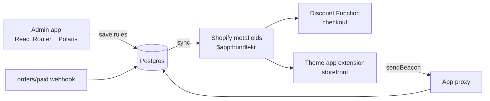

# BundleKit

One Shopify app for four things that raise order value: **product bundles**, **volume discounts**, **cart upsells** and a
**free-shipping progress bar**. It starts as a custom (unlisted) app for 2 to 5 D2C stores, and the App Store listing path
stays open.

> Working name. Built with the Shopify React Router app template, Prisma/Postgres, Shopify Functions and a theme app extension.

## What it does

| Feature                            | Shopper sees                                                | How the discount is enforced                                                              |
| ---------------------------------- | ----------------------------------------------------------- | ----------------------------------------------------------------------------------------- |
| **Bundles** (fixed, mix-and-match) | Bundle card on the product page with one add-to-cart button | Discount Function keyed on a `_bundle_id` line property. Incomplete bundle = no discount. |
| **Volume discounts**               | Tier table on the product page, active tier highlights      | Discount Function reads the tier rule from a metafield                                    |
| **Cart upsell**                    | 1 to 3 offer cards in the cart drawer or page               | Same Function, via `_upsell_id` line property                                             |
| **Free-shipping bar**              | Progress bar above the cart subtotal                        | Display only (shipping itself is configured in Shopify)                                   |

The storefront only **displays** prices. Every discount is computed in a Shopify Function, so it holds at checkout and with
any theme. The browser is never trusted for a price.

## How it works



- Rules live in Postgres and are synced to metafields. The storefront and the Functions read **only metafields**, so the
  app server is never on the render or checkout path.
- Each bundle or volume rule gets its own automatic discount node with a small config metafield, because Functions receive
  `null` for metafield values over 10,000 bytes. See [docs/DECISIONS.md](docs/DECISIONS.md).
- Pricing math is pure TypeScript in `packages/pricing` (integer minor units, half-up rounding, exact allocation), shared by
  the Function, the admin preview and the storefront.

## Repository layout

```
app/                       Admin app (React Router): routes, services, webhooks, app proxy
  services/sync/           Postgres -> metafield sync, retry, reconciliation
packages/
  pricing/                 Pure money math + property tests (fast-check)
  config-schema/           Versioned zod contract for every metafield
extensions/                bundlekit-discount (Function), bundlekit-theme (blocks + app embed)
packages/storefront        Vanilla-JS storefront modules (built into the theme extension by npm run build:storefront)
packages/widgets           Shared card renderer, strings, CSS, contrast helper
prisma/                    Schema, migrations, seed
tests/                     Vitest suites (webhooks, sync, schema, logging, crypto)
docs/                      UX_SPEC, DECISIONS, BACKLOG, RUNBOOK, METRICS, SECURITY, REVIEW, CLIENT_GUIDE, PILOT_*, LISTING_GAPS
```

## Status

All code below is built and covered by automated tests (227 tests, run in CI). **Nothing has been run on a real Shopify store yet**:
no install, no checkout, no theme rendering, no Lighthouse. That is the main remaining risk; the exact steps are the
"Dev-store verification checklist" in [docs/RUNBOOK.md](docs/RUNBOOK.md).

| Phase | Scope                                                                       | State                                                                                                     |
| ----- | --------------------------------------------------------------------------- | --------------------------------------------------------------------------------------------------------- |
| 0     | Scaffold, Prisma schema, HMAC-verified idempotent webhooks, CI              | Built, tested                                                                                             |
| 1     | Pricing core (property-tested), metafield contract, sync, reconcile         | Built, tested against a fake Shopify                                                                      |
| 2     | Discount Function (JS, fails open), bundle wizard and list, Home checklist  | Built; 24 fixture carts pass. **Function not yet built with the Shopify CLI**                             |
| 3     | Volume discounts (tiers, dates in shop time zone, bundle conflicts)         | Built, tested                                                                                             |
| 4     | Theme app extension: Bundle and Volume blocks                               | Built; jsdom-tested. **Not rendered on a real theme**                                                     |
| 5     | Cart embed: shipping bar, upsells, theme adapters, kill switch, settings    | Built; jsdom-tested. **Adapters unverified on real themes**                                               |
| 6     | Analytics and attribution, KPIs, CSV                                        | Built; 10-order hand calculation matches. **Webhook payload assumptions unverified**                      |
| 7     | Onboarding checklist, client guide, settings with contrast warnings         | Built. Not timed with a new user                                                                          |
| 8     | Hardening: privacy webhooks, tenant-scope test, health check, audit, review | Partly done. Error tracking, backups, Playwright E2E need accounts or a store                             |
| 9     | 30-day pilot                                                                | **Not started** (needs two real stores). Plan and decision gate: [docs/PILOT_PLAN.md](docs/PILOT_PLAN.md) |
| 10    | App Store listing                                                           | **Not started and gated** on the pilot. Gaps: [docs/LISTING_GAPS.md](docs/LISTING_GAPS.md)                |

Known limits: about 10 to 20 active rules per shop (checkout config budget), per-instance rate limiting, last-write-wins sync.
See [docs/REVIEW.md](docs/REVIEW.md) for the full list of findings and which are still open.

## Getting started

Prerequisites: Node 22.12+, a Postgres database (Supabase works), a Shopify Partner account with a development store, and
the [Shopify CLI](https://shopify.dev/docs/api/shopify-cli).

```bash
cp .env.example .env          # fill in values; never commit .env
npm install
npx prisma migrate deploy
npm run db:seed               # optional: sample dev shop
shopify app config link       # writes client_id into shopify.app.toml
npm run dev                   # shopify app dev
```

Generate secrets:

```bash
openssl rand -base64 32       # TOKEN_ENCRYPTION_KEY
openssl rand -hex 32          # CRON_SECRET (optional, enables /api/jobs/reconcile)
```

## Scripts

| Command                | What it does                                             |
| ---------------------- | -------------------------------------------------------- |
| `npm run lint`         | ESLint                                                   |
| `npm run format:check` | Prettier check (`npm run format` to fix)                 |
| `npm run typecheck`    | React Router typegen + `tsc --noEmit`                    |
| `npm test`             | Vitest (unit, property and integration-with-fakes tests) |
| `npm run build`        | Production build                                         |
| `npm run db:migrate`   | Create a migration in development                        |

CI (`.github/workflows/ci.yml`) runs migrations on a clean Postgres, then lint, format, typecheck and tests on every push.

## Security and compliance

- Every webhook route verifies the HMAC; the three mandatory privacy webhooks and `app/uninstalled` are handled, with
  idempotency receipts.
- Access and refresh tokens are encrypted at rest (AES-256-GCM). Logs redact tokens, auth headers and emails.
- All environment variables are validated at boot; the app refuses to start with a clear list of what is wrong.
- We store no customer data beyond order IDs and totals.

## Documentation

- [docs/UX_SPEC.md](docs/UX_SPEC.md): screens, widgets, UX rules, data model
- [docs/DECISIONS.md](docs/DECISIONS.md): versions, scopes, limits, and why
- [docs/RUNBOOK.md](docs/RUNBOOK.md): env vars, deploy, rollback, sync operations
- [docs/BACKLOG.md](docs/BACKLOG.md): deferred ideas (v1 scope is the four features above)
